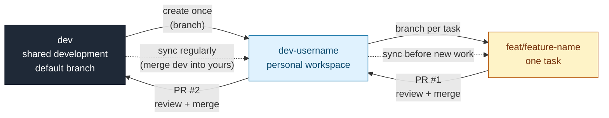
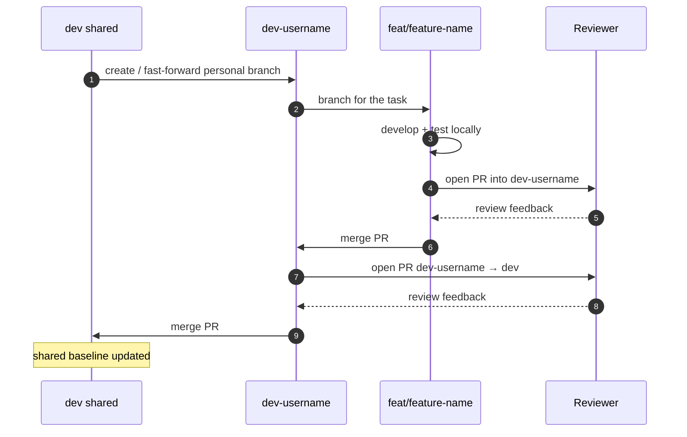

# Contributing to Custodian Homes (Keja Yangu)

This is the team's primary reference for onboarding, Git collaboration, contribution
procedures, and project-specific development standards. It is written against the
**actual** repository — every command, path, and convention below was verified in the
codebase at the time of writing.

> **Repository:** `dev-mwero/keja-yangu` · **Package name:** `custodian-homes`
> **Default branch:** `dev` · **Runtime:** Node.js 22 · **Package manager:** npm
> (`package-lock.json`)

---

## Legend — existing practice vs. team convention

To keep this document honest, every rule is tagged:

| Tag | Meaning |
| --- | --- |
| ✅ **Existing** | Verified in the repository today (scripts, config, code, CI, history). |
| 📋 **Team convention** | Adopted by this guide. Not necessarily enforced by tooling yet. |
| ⚠️ **Gap / recommendation** | Something missing or inconsistent that the team should decide on. |

If a statement is not tagged, it is a direct observation from the audit.

---

## Table of contents

1. [Introduction](#1-introduction)
2. [Project Overview](#2-project-overview)
3. [Repository Architecture](#3-repository-architecture)
4. [Development Environment Setup](#4-development-environment-setup)
5. [Git Branching Strategy](#5-git-branching-strategy)
6. [Branch Naming Conventions](#6-branch-naming-conventions)
7. [Developer Onboarding](#7-developer-onboarding)
8. [Feature Development Workflow](#8-feature-development-workflow)
9. [Pull Request Process](#9-pull-request-process)
10. [Commit Message Standards](#10-commit-message-standards)
11. [Code Standards](#11-code-standards)
12. [Testing and Quality Assurance](#12-testing-and-quality-assurance)
13. [Security Guidelines](#13-security-guidelines)
14. [Git Commands Cheat Sheet](#14-git-commands-cheat-sheet)
15. [Collaboration Rules](#15-collaboration-rules)
16. [New Developer Checklist](#16-new-developer-checklist)

---

## 1. Introduction

Custodian Homes (the repository is still named `keja-yangu`) is a Kenyan rental and
property-management platform. It is a single Next.js application that serves three
surfaces at once:

- the public marketing and property-listing site,
- six role-scoped dashboards,
- a versioned REST API under `/api/v1`.

This document exists so that a new contributor can go from `git clone` to a reviewed
pull request without guessing, and so that existing contributors share one predictable
workflow. The Git model is intentionally simple: **one shared branch, one persistent
branch per developer, one short-lived branch per task.**

### What this document covers

- How the codebase is organised and how to run it.
- The `dev → dev-username → feat/...` branching model and the PR flow back.
- Commit, PR, and code standards.
- Testing, linting, and type-checking gates.
- Security rules specific to this product.
- A copy-paste command reference.

### What this document does not cover

- Release or deployment branching. Deployment is out of scope here; this guide is
  deliberately limited to the development workflow around `dev`.
- Product requirements. Feature intent lives in `docs/plans/`.
- Infrastructure operations. See `docs/runbooks/` and `docker-compose.yml`.

---

## 2. Project Overview

### 2.1 Stack (verified from `package.json` and config)

| Layer | Technology |
| --- | --- |
| Framework | Next.js 16 (App Router) |
| Language | TypeScript 5, `strict: true` |
| UI runtime | React 19 |
| Styling | Tailwind CSS 4 + `tailwindcss-animate` |
| Components | shadcn/ui primitives on Radix UI |
| Icons / motion | `lucide-react`, `framer-motion` |
| Forms | `react-hook-form` + `@hookform/resolvers` + Zod 4 |
| Database | MongoDB via Mongoose 9 |
| Auth | JWT (`jsonwebtoken`) in an httpOnly cookie, `bcryptjs` hashing |
| Email | Nodemailer |
| File uploads | UploadThing |
| Payments | Paystack (platform) + Safaricom Daraja M-Pesa (per admin) |
| Unit/integration tests | Vitest 5 + Testing Library (jsdom) |
| E2E tests | Playwright (Chromium) |
| Lint + format | Biome 2 |
| CI | GitHub Actions |

### 2.2 Roles in the current code

The `User.role` union in `src/models/User.ts` is:

```text
tenant | caretaker | custodian | admin | broker | system-admin
```

`src/lib/role-management.ts` splits these into `USER_ROLES` and `ASSIGNABLE_ROLES`.
`system-admin` is deliberately **not** assignable over HTTP — it is granted and revoked
only through the audited CLI (`npm run admin:grant`, backed by
`scripts/grant-system-admin.ts`).

> ⚠️ **Documentation drift:** `docs/PROJECT_STRUCTURE.md` and the dashboard list in
> `README.md` still describe an `owner` role and an owner-centric `ownerId` model. Those
> documents predate the multi-admin/broker revamp. Where they disagree, the code and
> `docs/plans/multi-admin-revamp-*.md` are authoritative. This is tracked as an open item
> in [Section 16](#16-new-developer-checklist).

### 2.3 External integrations and where their config lives

| Integration | Purpose | Configuration |
| --- | --- | --- |
| MongoDB | All persistent state | `MONGODB_URI` |
| Paystack | Platform-wide card/bank checkout + webhook | `PAYSTACK_SECRET_KEY`, `PAYSTACK_PUBLIC_KEY` |
| Safaricom Daraja (M-Pesa) | Per-admin STK push + callback | `OwnerPaymentConfig` rows, secrets encrypted at rest |
| Nodemailer | Verification, reset, invites, notification email | `EMAIL_*` |
| UploadThing | Property image uploads | `UPLOADTHING_TOKEN` |

### 2.4 Scale of the codebase (audit snapshot)

- **117** API route handlers (`src/app/api/**/route.ts`)
- **247** Vitest test files (colocated `*.test.ts(x)`)
- **42** Mongoose models in `src/models/` (excluding colocated tests)
- **100** domain modules in `src/lib/` (excluding colocated tests)

---

## 3. Repository Architecture

### 3.1 Top-level layout (verified)

```text
.
├── .github/workflows/ci.yml     GitHub Actions: lint → typecheck → build → test
├── docs/
│   ├── PROJECT_STRUCTURE.md     codebase map (partially stale — see §2.2)
│   ├── plans/                   design intent; read before large changes
│   └── runbooks/                operational procedures (role mgmt, backfills, cutover)
├── e2e/                         Playwright specs + auth helpers + README
├── public/                      static assets
├── scripts/                     one-off backfills / migrations / seeding (tsx)
├── src/
│   ├── app/                     App Router pages + API route handlers
│   ├── components/              feature components + shadcn `ui/` primitives
│   ├── config/dashboardNav.ts   per-role navigation definition
│   ├── contexts/                React context providers
│   ├── data/                    demo/seed fixtures (not the production data source)
│   ├── hooks/                   client data fetching and mutations
│   ├── lib/                     domain logic, guards, schemas, integrations
│   ├── models/                  Mongoose schemas
│   ├── test/                    Vitest setup + factories/model mocks
│   ├── types/                   shared client-facing serialized types
│   └── proxy.ts                 Next 16 route proxy (edge auth gate)
├── biome.json                   formatting + lint rules
├── vitest.config.ts             jsdom, setup file, coverage
├── playwright.config.ts         E2E bootstrap
├── next.config.ts               CSP/security headers, redirects, image config
├── tailwind.config.ts
├── Dockerfile                   multi-stage standalone build
├── docker-compose.yml           self-hosted runtime
└── .env.example                 tracked environment template
```

This is a **single application**, not a monorepo. There are no workspaces, no
`packages/`, and no separate backend service. "Frontend" and "backend" are two halves of
the same Next.js process:

- **Server:** `src/app/api/v1/**/route.ts`, `src/lib/**`, `src/models/**`
- **Client:** `src/app/**/page.tsx`, `src/components/**`, `src/hooks/**`

### 3.2 App Router structure

```text
src/app/
├── page.tsx                     landing page
├── properties/                  public listing + detail
├── auth/                        sign in/up, verify, forgot/reset password
├── dashboard/
│   ├── layout.tsx               client role gate (AuthGuard)
│   ├── admin/
│   ├── broker/
│   ├── custodian/
│   ├── caretaker/
│   ├── tenant/
│   └── system-admin/
├── api/
│   ├── auth/                    session actions + /me + /logout
│   ├── uploadthing/             UploadThing handler
│   └── v1/                      versioned REST API
└── about, contact, faq, pricing, privacy, terms   public marketing pages
```

Dashboard navigation is data-driven from `src/config/dashboardNav.ts`.
`next.config.ts` redirects retired tenant URLs to their consolidated pages.

### 3.3 API route groups under `src/app/api/v1`

| Group | Responsibility |
| --- | --- |
| `properties`, `units`, `property-types` | Portfolio structure and taxonomy |
| `properties/[id]/structure`, `service-fees` | Structure reconciliation, itemized fees |
| `applications`, `leads` | Prospect pipeline |
| `tenants`, `assignments`, `leases` | Tenancy and occupancy |
| `invoices`, `payments`, `amounts`, `tenant/me` | Billing and settlement |
| `move-requests` | Move-in / move-out approvals |
| `chat`, `complaints`, `announcements`, `documents`, `contact` | Communications |
| `notifications`, `settings`, `users`, `capabilities` | Inbox, preferences, identity |
| `listings`, `marketplace`, `brokers`, `attribution`, `commissions` | Marketplace and broker domain |
| `tasks`, `admin`, `recycle-bin`, `search` | Work management and administration |

`src/app/api/v1/_helpers.ts` and `_service-fees.ts` hold shared route helpers.

### 3.4 Domain layer (`src/lib`)

The most important modules — treat these as invariants, not utilities:

| Module | Owns |
| --- | --- |
| `permissions.ts` | JWT verification, `requirePermission`, action catalogue, scoping |
| `authorization.ts` / `authorization-policy.ts` / `policy-resources.ts` | Scoped authorization decisions |
| `allocation.ts` | **The only writer** of unit occupancy and active leases |
| `invoice-generation.ts`, `invoicing.ts`, `invoice-numbering.ts` | Billing |
| `service-fees.ts` | Service-fee resolution (template → override → legacy) |
| `payments/settle.ts` | Provider-agnostic settlement |
| `notifications.ts`, `email.ts` | Fan-out and delivery |
| `mongoose-soft-delete.ts` | Soft-delete plugin |
| `schemas/` | Zod schemas, re-exported from `schemas/index.ts` |
| `crypto.ts` | AES-256-GCM field encryption for PII |
| `rate-limit.ts`, `rate-limit-auth.ts` | In-memory rate limiting |
| `pagination.ts` | `parsePagination` / `buildPaginationResult` |

### 3.5 Data layer

- Models are Mongoose schemas in `src/models/*.ts`, one per file, PascalCase filenames.
- Collections use Mongoose's default pluralisation.
- **Soft delete** is opt-in per model through `softDeletePlugin`, which adds
  `deletedAt`, default read filtering, and `softDelete*` / `restore*` helpers.
  Soft-deleted models today include `Property`, `Unit`, `Tenant`, `Lease`, `Invoice`,
  `PropertyType`, `Lead`, `Application`, `Listing`, and others.
- **Partial unique indexes** make "unique among live rows" possible alongside soft
  delete. Preserve this pattern when adding constraints.
- **Money** is stored in major KES units on invoices; conversion to minor units happens
  only at the payment-provider boundary.
- **Occupancy** is a cache. `Lease.unitId` is authoritative; `Unit.tenantId[]` and
  `Unit.status` must only be written by `src/lib/allocation.ts`.

### 3.6 State management

There is no Redux/Zustand/React Query. Client state is handled by:

- **Server state:** feature hooks in `src/hooks/` that call the REST API with `fetch`
  and manage loading/error/refresh state.
- **Session:** `useAuth` (`src/hooks/use-auth.tsx`) backed by `/api/auth/me`.
- **Contexts:** `src/contexts/` for cross-cutting UI state.
- **Demo fixtures:** `src/data/*.ts` is UI/demo fallback data, never the production
  source of truth.

Do not introduce a global state library without a team decision — it would be a new
runtime dependency and a cross-cutting architectural change.

### 3.7 Where to change what

| Task | Start here |
| --- | --- |
| Add/modify an API endpoint | `src/app/api/v1/.../route.ts`, guard with `requirePermission`, validate with `src/lib/schemas` |
| Add a persisted entity | `src/models/`, apply `softDeletePlugin` if applicable, add indexes |
| Change occupancy/allocation | `src/lib/allocation.ts` only |
| Change invoice calculation | `src/lib/invoice-generation.ts`, `invoicing.ts`, `service-fees.ts` |
| Change payment settlement | `src/lib/payments/settle.ts` and providers |
| Change notifications | `src/lib/notifications.ts`, `src/lib/email.ts` |
| Change authorization | `src/lib/permissions.ts` + route `resource` arguments |
| Change dashboard navigation | `src/config/dashboardNav.ts` |
| Change UI feature | Matching folder in `src/components/` + hook in `src/hooks/` |
| Change form validation | `src/lib/schemas/` |
| Add a migration | `scripts/`, mirroring the dry-run/idempotent pattern |
| Change session/auth | `src/app/api/auth/route.ts`, `src/lib/jwt.ts`, `src/lib/permissions.ts`, `src/proxy.ts` |

---

## 4. Development Environment Setup

### 4.1 Prerequisites

| Requirement | Version / note |
| --- | --- |
| Node.js | **22** (matches CI and `Dockerfile`) |
| npm | Ships with Node 22; `package-lock.json` is committed |
| MongoDB | A reachable MongoDB instance (Atlas or local) |
| Git | Any recent version |

Optional but expected for feature work:

- A Paystack **test** key pair (the app runs in test mode).
- An UploadThing token (property image uploads only).
- SMTP credentials (email verification, invites, notifications).

### 4.2 Install

```bash
npm install
```

CI and Docker use the reproducible form:

```bash
npm ci
```

Use `npm ci` when you need a clean, lockfile-exact install (e.g. reproducing a CI
failure). Use `npm install` only when you are intentionally changing dependencies.

### 4.3 Configure the local environment

The tracked template is `.env.example`. Copy it and fill in real values:

```bash
cp .env.example .env.local
```

`.env*` is gitignored except `.env.example`. **Never commit `.env.local` or any file
containing real credentials.**

Variable reference (names only — values must never be committed):

| Variable | Required | Purpose |
| --- | --- | --- |
| `MONGODB_URI` | Yes | MongoDB connection string |
| `JWT_SECRET` | Yes | Signs the `keja-token` session JWT |
| `FIELD_ENCRYPTION_KEY` | Yes in production | 32-byte key (base64 or 64-char hex) for PII encryption |
| `NEXT_PUBLIC_APP_URL` | Yes | Public origin; also inlined into the client bundle at build time |
| `NODE_ENV` | No | `development` locally |
| `EMAIL_HOST` / `EMAIL_PORT` / `EMAIL_USER` / `EMAIL_PASS` / `EMAIL_FROM` / `EMAIL_SECURE` | For email flows | Nodemailer SMTP |
| `PAYSTACK_SECRET_KEY` / `PAYSTACK_PUBLIC_KEY` | For payments | Paystack test keys |
| `MPESA_CALLBACK_SECRET` | Production | Callback URL token; falls back to `JWT_SECRET` |
| `UPLOADTHING_TOKEN` | For uploads | UploadThing API key |
| `NOTIFICATION_RETENTION_DAYS` | No | TTL for notifications (default `90`) |
| `COMMISSION_PAYOUTS_ENABLED` | No | Execution gate for commission payouts; keep `false` |
| `ROLE_MANAGEMENT_ENABLED` | No | System-admin role-management surface; keep `false` until the runbook is signed off |

Two environment gotchas worth knowing:

1. **`NODE_ENV` in the template.** `.env.example` ships `NODE_ENV=production`, which is
   correct for the Docker runtime but wrong for local development. Local `.env.local`
   should use `NODE_ENV=development`.
2. **`FIELD_ENCRYPTION_KEY` is not rotatable casually.** Changing it makes existing
   encrypted national IDs unreadable. Generate one with
   `openssl rand -base64 32` and keep it stable per environment.

Generate a key:

```bash
openssl rand -base64 32
```

### 4.4 Start the project

```bash
npm run dev
```

Open <http://localhost:3000>.

### 4.5 Available scripts (exact, from `package.json`)

| Command | What it does |
| --- | --- |
| `npm run dev` | `next dev` — development server |
| `npm run build` | `next build` — production build |
| `npm run start` | `next start` — serve the production build |
| `npm run lint` | `biome lint .` |
| `npm run format` | `biome format --write .` |
| `npm run check` | `biome check --write .` — format + lint + import order (**mutates files**) |
| `npm run test` | `vitest run` — unit/integration suite once |
| `npm run test:watch` | `vitest` — watch mode |
| `npm run test:coverage` | `vitest run --coverage` |
| `npm run test:e2e` | `playwright test` |
| `npm run typecheck` | `tsc --noEmit` |
| `npm run audit:phase9` | `tsx scripts/phase9-readiness.ts` |
| `npm run admin:grant` | Grant/revoke `system-admin` via audited CLI |
| `npm run seed:clean` | Wipe and reseed the database |
| `npm run reconcile:attributions` | Broker attribution reconciliation |
| `npm run reconcile:commissions` | Commission reconciliation |
| `npm run backfill:commissions` | Commission backfill |
| `npm run backfill:tasks` | Task-permission backfill |
| `npm run backfill:chat` | Chat approval-state backfill |
| `npm run backfill:user-codes` | User-code backfill |
| `npm run migrate:user-code-index` | User-code index migration |

⚠️ `seed:clean` and every `--apply` migration **write to the configured database**.
Never run them against a shared or production database without explicit sign-off.

### 4.6 Utility scripts (`scripts/`)

These are one-off, idempotent backfills and migrations executed with `tsx`. They:

- load `.env.local` explicitly (`dotenv.config({ path: ".env.local" })`),
- **commonly** default to dry-run and require `--apply` (or an equivalent flag) to
  write — read the script header before running it,
- declare local schemas instead of importing app models, so they run without the `@/`
  alias,
- re-guard every write against the selection predicate so concurrent changes are never
  overwritten.

When adding a migration, mirror that pattern exactly and document it in `docs/runbooks/`.

### 4.7 Docker (optional, self-hosted)

```bash
docker compose up --build
```

`docker-compose.yml` reads the same variables from your shell/`.env`. `next.config.ts`
only enables `output: "standalone"` outside Vercel.

---

## 5. Git Branching Strategy

The team uses a developer-centered workflow built around `dev`. There are exactly three
kinds of branches you will work with.

### 5.1 Shared development branch — `dev`

✅ **Existing:** `dev` is the repository's default branch (`git remote show origin`
reports `HEAD branch: dev`), and CI runs on it.

- It is the default branch and the common development baseline.
- It contains integrated, shared contributions.
- It must remain stable enough for the team to integrate and test against.
- 📋 **Team convention:** it must not receive direct pushes. All contributions arrive
  through Pull Requests.

### 5.2 Personal developer branches — `dev-username`

Each developer owns exactly one **persistent** personal branch, created from `dev`.

```text
dev-mwero
dev-jane
dev-john
```

✅ **Existing:** `dev-mwero` is already in use as the source branch for merged PRs
(e.g. PR #88, `dev-mwero/feat/user-code-identifier`).

Rules:

- Every team member works through their own personal branch.
- A personal branch is a **workspace**, not a branch for one task.
- Do not push to another developer's personal branch without their explicit
  authorization.
- Keep it synchronized with `dev` regularly (see §8, Step 2).
- Your completed work reaches shared `dev` only through a PR from `dev-username` → `dev`.

### 5.3 Task branches

Every feature, bug fix, refactor, documentation change, test, or chore gets its own
short-lived branch, created **from your personal branch** — never from `dev`.

```text
feat/user-authentication
fix/login-validation
refactor/database-layer
docs/setup-guide
test/auth-flow
chore/update-dependencies
```

Rules:

- Created from `dev-username`, not from `dev`.
- One task or one logical unit of work per branch.
- Merged back into `dev-username` by PR, then deleted.
- Rebase or merge from your personal branch as needed, but never rewrite a branch
  another person is reviewing without telling them.

### 5.4 Branch hierarchy and contribution direction

**Creation (branching out):**

```text
dev → dev-username → feat/feature-name
```

**Contribution (merging back):**

```text
feat/feature-name → dev-username → dev
```

The arrows represent the progression of code through Pull Requests and merges. Code is
created downward and integrated upward; nothing skips a level.





### 5.5 What is explicitly out of scope

This guide covers the development workflow only. It does not define release, hotfix, or
deployment branch procedures. `main` exists and is used by CI's deploy job, but changes
to `main` are managed outside this document.

---

## 6. Branch Naming Conventions

📋 **Team convention** (the `type/description` prefixes are already observable in the
repository's history, e.g. `feat/`, `fix/`, `refactor/`, `docs/`, `test/`, `chore/`).

| Branch type | Pattern | Example |
| --- | --- | --- |
| Shared development | `dev` | `dev` |
| Personal development | `dev-username` | `dev-mwero` |
| Feature | `feat/description` | `feat/user-dashboard` |
| Bug fix | `fix/description` | `fix/login-error` |
| Refactoring | `refactor/description` | `refactor/auth-service` |
| Documentation | `docs/description` | `docs/api-guide` |
| Chore / tooling | `chore/description` | `chore/update-dependencies` |
| Tests | `test/description` | `test/auth-flow` |

Rules:

- Lowercase only.
- Hyphens between words; no spaces, underscores, or slashes beyond the single type slash.
- Keep it short but specific: `fix/invoice-overdue-sweep`, not `fix/bug`.
- Include the issue or task number when one exists: `feat/142-unit-favourites`.

---

## 7. Developer Onboarding

Copy-paste sequence for a new developer. Replace `yourname` with your actual handle.

### 7.1 Clone the repository

The configured remote is an SSH alias:

```bash
git clone git@github-sass:dev-mwero/keja-yangu.git
cd keja-yangu
```

If your machine does not have the `github-sass` SSH alias configured, use the standard
GitHub SSH or HTTPS form instead:

```bash
# HTTPS
git clone https://github.com/dev-mwero/keja-yangu.git
cd keja-yangu
```

### 7.2 Install dependencies

```bash
npm install
```

### 7.3 Configure the local environment

```bash
cp .env.example .env.local
```

Then edit `.env.local`:

- set `MONGODB_URI`, `JWT_SECRET`, `FIELD_ENCRYPTION_KEY`, `NEXT_PUBLIC_APP_URL`,
- set `NODE_ENV=development`,
- add `EMAIL_*` if you need verification/invite emails,
- add `PAYSTACK_*` / `UPLOADTHING_TOKEN` only for the features you are working on.

Never commit `.env.local`. It is gitignored.

### 7.4 Start the project

```bash
npm run dev
```

Then open <http://localhost:3000>.

### 7.5 Verify your toolchain before writing code

```bash
npm run check      # Biome format + lint (mutates files)
npm run typecheck  # tsc --noEmit
npm run test       # vitest run
```

All three should pass on a clean `dev`. If they do not, report it before starting work.

### 7.6 Create your personal development branch

Start from `dev`:

```bash
git fetch origin
git checkout dev
git pull origin dev
git checkout -b dev-yourname
git push -u origin dev-yourname
```

If your personal branch **already exists** remotely (for example you are on a second
machine), check it out and track it instead of recreating it:

```bash
git fetch origin
git checkout -b dev-yourname origin/dev-yourname
# or, if a local branch of the same name exists:
git checkout dev-yourname
git pull origin dev-yourname
```

Confirm the tracking relationship:

```bash
git branch -vv
```

You should see `dev-yourname ... [origin/dev-yourname]`.

### 7.7 Create your first feature branch

```bash
git checkout dev-yourname
git pull origin dev-yourname
git checkout -b feat/feature-name
```

All feature work begins from the personal development branch — not from `dev`.

---

## 8. Feature Development Workflow

The ten steps below are mandatory. Each step maps to a real command or check in this
repository.

### Step 1 — Synchronize with the remote

```bash
git fetch origin --prune
```

### Step 2 — Synchronize your personal branch with `dev`

```bash
git checkout dev
git pull origin dev
git checkout dev-yourname
git merge dev          # or: git rebase origin/dev, if you prefer linear history
git push origin dev-yourname
```

Resolve conflicts **on your personal branch**, never on `dev`. If a rebase goes wrong,
`git rebase --abort` and merge instead — do not force-push a shared branch.

### Step 3 — Create a task branch

```bash
git checkout -b feat/feature-name
```

Use the naming table in [Section 6](#6-branch-naming-conventions).

### Step 4 — Develop and test

Follow the standards in [Section 11](#11-code-standards). Before committing, run the
same gates CI runs:

```bash
npm run check
npm run typecheck
npm run test
npm run build          # for changes that affect routing, config, or server code
```

For a single test file while iterating:

```bash
npx vitest run src/lib/allocation.test.ts
```

If your change affects a critical role flow, also run:

```bash
npm run test:e2e
```

(Playwright self-skips flows whose seeded credentials are not configured — see
`e2e/README.md`.)

### Step 5 — Commit

```bash
git add <files>
git commit -m "feat(invoices): add overdue sweep scoping"
```

See [Section 10](#10-commit-message-standards). Stage specific files rather than
`git add -A` so you do not accidentally include `.env.local`, build output, or unrelated
work.

### Step 6 — Push the task branch

```bash
git push -u origin feat/feature-name
```

### Step 7 — Open a Pull Request into your personal branch

Target: `dev-yourname` ← `feat/feature-name`

Example: `feat/user-authentication → dev-mwero`

Do **not** open the first PR against `dev`. The personal branch is the first review and
integration gate.

### Step 8 — Review and merge

- Address review comments on the same task branch.
- Re-run the quality gates after changes.
- Resolve conflicts by merging `dev-yourname` into your task branch.
- Merge the PR into `dev-yourname`.

### Step 9 — Synchronize your personal branch and clean up

```bash
git checkout dev-yourname
git pull origin dev-yourname
git branch -d feat/feature-name
git push origin --delete feat/feature-name   # optional; GitHub can do this on merge
```

If the PR was squash-merged, `git branch -d` may refuse; use `git branch -D` only after
confirming the work is on the remote.

### Step 10 — Contribute to shared development

When your personal branch holds a stable, coherent set of changes ready for the team:

- Open a PR: `dev-mwero → dev`
- Ensure CI is green.
- Request review from the team.
- Merge only after approval and a passing pipeline.

This PR is the team's integration point. Every contribution reaches `dev` through it.

---

## 9. Pull Request Process

### 9.1 PR standards

Every PR should:

- Have a clear, descriptive title (see §10 for the title convention).
- Target the correct branch (see §9.2).
- Explain **what** changed and **why** it was necessary.
- Reference a task or issue where one exists (`Closes #123`, `Refs #123`).
- Include testing details: what you ran and what passed.
- Stay scoped — no unrelated refactors, formatting sweeps, or dependency bumps.
- Contain no secrets, credentials, tokens, or `.env` files.
- Have merge conflicts resolved before merging.
- Address all review feedback or explicitly defer it with a reason.
- Match the existing architecture and conventions in this document.

### 9.2 PR destinations

| Contribution | Target branch |
| --- | --- |
| Feature branch | Personal `dev-username` |
| Bug fix branch | Personal `dev-username` |
| Documentation branch | Personal `dev-username` |
| Test / chore / refactor branch | Personal `dev-username` |
| Personal development contribution | Shared `dev` |

Nothing targets `dev` directly except a `dev-username → dev` PR.

### 9.3 PR title convention

✅ **Existing:** the repository uses Conventional Commit style for both commits and PR
titles. Use the same format:

```text
feat(invoices): add overdue sweep scoping
fix(chat): require send_messages for caretaker replies
docs(contributing): document the dev branching model
```

### 9.4 PR description template

📋 **Team convention.** There is currently no `.github/pull_request_template.md`; copy
this block into your PR description until one is added.

```markdown
## What changed

<!-- One or two sentences. What is different after this PR? -->

## Why

<!-- The problem, requirement, or bug. Link the plan/issue. -->

Refs: #

## How it was tested

- [ ] `npm run check`
- [ ] `npm run typecheck`
- [ ] `npm run test`
- [ ] `npm run build` (if routes/config/server code changed)
- [ ] Manual verification (describe below)

<!-- Describe manual steps, roles exercised, and edge cases. -->

## Screenshots / recordings

<!-- Required for visible UI changes. -->

## Risk and rollback

<!-- Data migrations, index changes, feature flags, or anything irreversible. -->

## Checklist

- [ ] Target branch is correct (`dev-username` for task PRs, `dev` for integration)
- [ ] No secrets, `.env` files, or credentials committed
- [ ] No unrelated changes
- [ ] Tests added or updated for behaviour changes
- [ ] Existing conventions and architecture respected
```

### 9.5 Review expectations

- Reviewers check correctness, scope, security, and test coverage — not personal style.
- Authors respond to every comment, even if only to say "deferred, because…".
- Discussions stay professional and about the code.
- A PR that changes authorization, money handling, allocation, or a data contract
  deserves a second reviewer.
- Do not approve your own PR.

### 9.6 CI gates

✅ **Existing:** `.github/workflows/ci.yml` runs on every push and PR to `dev` and
`main`.

| Job | Steps |
| --- | --- |
| `lint-and-build` | `npm ci` → `./node_modules/.bin/biome check .` → `npm run typecheck` → `npm run build` → `npm run test:coverage` |
| `test` | `npm ci` → `npm run test` |
| `deploy` | Only on push to `main` (out of scope for this guide) |

Note the difference: CI runs `biome check .` **without** `--write`, so formatting drift
fails the pipeline. Locally, `npm run check` fixes it. Run `npm run check` before
pushing.

---

## 10. Commit Message Standards

### 10.1 Existing convention

✅ **Existing:** the repository has an established **Conventional Commits** convention
with scopes. Examples from the actual history:

```text
feat(user): add unique CXXXXXX user code for identification
feat(chat): Phase 2 approval flow — frontend + tests
fix(tasks): scope task creates and guard custodian deletes
refactor(authz): carry ownerId through policy checks and unify request scope
docs(plans): add messaging approval flow plan
test(authz): backend test sweep for owner-scoped admin (WP12a)
chore(scripts): add caretaker task-permission backfill
```

Integration commits follow one of two shapes, both acceptable:

```text
Merge pull request #88 from dev-mwero/feat/user-code-identifier
merge: integrate feat/messaging-approval-flow into dev
```

### 10.2 Required format

```text
<type>(<scope>): <imperative summary>
```

- **type** — one of `feat`, `fix`, `refactor`, `docs`, `test`, `chore`, `perf`, `build`,
  `ci`, `style`.
- **scope** — the affected area, lowercase, matching the domain vocabulary already in
  use: `auth`, `properties`, `units`, `tenants`, `invoices`, `payments`, `chat`,
  `tasks`, `authz`, `plans`, `scripts`, `ui`, `nav`, `brand`, `seo`, `infra`.
- **summary** — imperative mood, lowercase, no trailing period, ~72 characters or less.

Examples:

```text
feat: add user authentication
fix: resolve login validation issue
refactor: simplify payment service
docs: update setup instructions
test: add authentication tests
chore: update dependencies
```

### 10.3 Why it matters

- **Traceability:** a `feat(invoices):` commit tells a reviewer and future maintainer
  exactly which subsystem changed without opening the diff.
- **Review quality:** scoped commits keep PRs reviewable and make `git log` a usable
  changelog.
- **Release notes:** typed commits can be grouped automatically later without rewriting
  history.
- **Bisecting:** small, single-purpose commits make regressions findable.

### 10.4 Do not use

```text
update
changes
fix stuff
final
new code
wip
asdf
```

Also avoid:

- Committing commented-out code or debug `console.log` statements.
- Mixing an unrelated refactor into a feature commit.
- Committing generated output (`coverage/`, `test-results/`, `.next/`,
  `tsconfig.tsbuildinfo`).

---

## 11. Code Standards

These are the project's **existing** conventions. Follow them rather than importing
habits from other codebases.

### 11.1 Formatting and linting

✅ **Existing:** Biome 2 is the single source of truth (`biome.json`).

| Rule | Value |
| --- | --- |
| Indentation | 2 spaces |
| Line width | 100 |
| Quotes | double |
| Trailing commas | all |
| `noUnusedImports` | error |
| `noNonNullAssertion` | error |
| `useImportType` | error |
| `useExhaustiveDependencies` | warn |
| `noArrayIndexKey` | off |

```bash
npm run check    # apply format + lint fixes
npm run format   # formatting only
npm run lint     # lint only
```

Do not introduce ESLint or Prettier configuration. Biome is the tool.

### 11.2 TypeScript

✅ **Existing:** `tsconfig.json` is strict and unforgiving:

```json
{
  "strict": true,
  "noUnusedLocals": true,
  "noUnusedParameters": true,
  "strictNullChecks": true,
  "noEmit": true,
  "moduleResolution": "bundler",
  "paths": { "@/*": ["./src/*"] }
}
```

- Use the `@/` path alias for intra-`src` imports.
- Prefer `import type { X } from "..."` for type-only imports (Biome enforces this).
- Do not use non-null assertions (`!`) — handle the null case.
- `allowImportingTsExtensions` is enabled, so `scripts/` may import with `.ts`
  extensions. Application code should import without extensions.

### 11.3 Naming conventions

| Kind | Convention | Example |
| --- | --- | --- |
| React components | PascalCase file + export | `InvoiceManager.tsx` |
| Hooks | `use-` kebab-case file, `useX` export | `use-invoices.tsx` → `useInvoices` |
| Domain modules | kebab-case file | `invoice-generation.ts` |
| Mongoose models | PascalCase file + model | `Invoice.ts` → `Invoice` |
| Zod schemas | camelCase export | `invoiceInput` |
| API routes | folder per resource, `[id]` for params | `invoices/[id]/route.ts` |
| Permission actions | `resource:verb` | `invoice:mark-paid` |
| CSS classes | Tailwind utilities via `cn()` | `cn("p-4", className)` |

### 11.4 Folder structure rules

- Route handlers live only in `src/app/api/**/route.ts`.
- Reusable domain logic belongs in `src/lib/`, not inside a route file.
- Feature UI belongs in `src/components/<feature>/`; primitives belong in
  `src/components/ui/`.
- Client components start with `"use client"`; keep the boundary as low as possible.
- Tests are colocated next to the code they cover.

### 11.5 API conventions

✅ **Existing pattern:**

```ts
import type { NextRequest } from "next/server";
import { NextResponse } from "next/server";
import { connectToDatabase } from "@/lib/mongoose";
import { requirePermission } from "@/lib/permissions";
import { invoiceInput } from "@/lib/schemas";

export async function POST(request: NextRequest) {
  const authError = await requirePermission(request, "invoice:manage");
  if (authError) return authError;

  await connectToDatabase();

  // parse + validate with Zod
  // perform the operation
  // return NextResponse.json({ data }, { status: 201 });
}
```

Rules:

1. **Authenticate and authorize first.** Return the guard's `NextResponse` unchanged on
   failure.
2. **Connect to the database** with `await connectToDatabase()` before any query.
3. **Validate every input** with Zod (`.trim()`, `z.coerce.number()`, `.optional()`).
   Never trust the client.
4. **Scope from the session**, never from query parameters.
5. **Response shapes:**
   - success: `{ data }` or `{ data, pagination }` via `buildPaginationResult`
   - failure: `{ error, issues? }` with the correct status
6. **Pagination:** use `parsePagination` / `buildPaginationResult`; limits are clamped
   to 1–100.
7. **Mutating browser routes:** call `checkSameOrigin`.
8. **Abuse-prone routes:** apply `rateLimit()`.
9. **Public reads:** project away internal fields
   (`.select("-ownerId -caretakerIds -createdById -__v")` or equivalent).
10. **Webhooks:** signature/URL-token auth, no cookie auth. Paystack verifies
    HMAC-SHA512 over the raw body.

### 11.6 Validation and error handling

- Schemas live in `src/lib/schemas/` and are re-exported from `schemas/index.ts`.
- Forms use `useForm({ resolver: zodResolver(schema) })`.
- Return specific statuses: `400` validation, `401` auth, `403` authorization, `404`
  missing, `409` conflict, `429` rate limit, `503` integration not configured.
- Never leak stack traces, driver errors, or secrets in a response.
- Notifications and emails are best-effort: they must never break the request path.

### 11.7 Database access and migrations

- Always `await connectToDatabase()`.
- Filter `deletedAt: null` unless you are intentionally working in the recycle bin.
- Use `softDeletePlugin` for new soft-deletable models; add partial unique indexes for
  live-only uniqueness.
- Use atomic `findOneAndUpdate` for claims (allocation, settlement, payment initiation).
- Never write `Unit.tenantId` / `Unit.status` or create leases directly from a route —
  go through `src/lib/allocation.ts`.
- Migrations go in `scripts/`, are idempotent, follow the dry-run/`--apply` pattern
  where applicable, and re-guard writes.

### 11.8 Authentication and authorization

- Session JWT lives in the httpOnly `keja-token` cookie.
- `src/proxy.ts` gates `/dashboard/*`; it is the Next 16 replacement for
  `middleware.ts`. Do not add `middleware.ts`.
- API routes re-read the user from MongoDB inside `requirePermission` — do not trust JWT
  claims alone for role or privilege decisions.
- Authorization actions are a closed union in `src/lib/permissions.ts`. Add a new action
  there rather than inventing string checks in a route.
- Scoping is always derived from the session. A `system-admin` may pass `ownerId`
  explicitly where a route supports it.

### 11.9 State management

- Server state: feature hook in `src/hooks/` using `fetch`.
- Session: `useAuth`.
- Cross-cutting UI: `src/contexts/`.
- Do not add a client state library without a team decision.

### 11.10 Reusable code

- Extract to `src/lib/` only when there is a second caller or a clear domain boundary.
- Prefer composition over configuration flags.
- Do not add comments that restate the code; explain *why* when it is non-obvious.
- Do not add unrelated refactors to a feature PR.

### 11.11 Logging and debugging

- Never log PII (national ID, phone, email) or secrets.
- Never log full request bodies that may contain credentials.
- Remove `console.log` debug statements before committing; use the project's existing
  notification/audit mechanisms where an event must be recorded.
- Prefer server-side errors with enough context to diagnose, but no sensitive payloads.

### 11.12 Dependency management

- Use npm and commit the updated `package-lock.json`.
- Do not add a dependency for something the standard library or an existing dependency
  already does.
- New runtime dependencies are architectural decisions — raise them in the PR
  description and expect review.
- Keep dependency bumps in their own `chore(deps):` PR.

---

## 12. Testing and Quality Assurance

### 12.1 Unit and integration tests (Vitest)

✅ **Existing:**

- Runner: Vitest with `jsdom`, `globals: true`, 30s test/hook timeout.
- Setup: `src/test/setup.ts` (Testing Library cleanup, Radix pointer/scroll stubs,
  `ResizeObserver` stub, `next/navigation` and `use-auth` mocks).
- Tests are **colocated**: `src/**/*.test.ts(x)` next to the source file.
- Route tests that need Node APIs opt in with:

  ```ts
  /** @vitest-environment node */
  ```

- Helpers in `src/test/utils/`:
  - `factories.ts` — object-id and model factories
  - `model-mocks.ts` — Mongoose model stubs and query builders
  - `render-with-auth.tsx` — auth-aware render
  - `api-request.ts` — route-test request helpers

Commands:

```bash
npm run test                                  # full suite
npx vitest run src/lib/allocation.test.ts     # one file
npm run test:watch                            # watch mode
npm run test:coverage                         # coverage report
```

### 12.2 What to test

- The happy path.
- Authorization boundaries (wrong role, wrong scope, missing privilege).
- Validation failures and conflict cases (`409`).
- Edge cases: empty results, soft-deleted rows, duplicate keys, partial payments.
- Idempotency where the code claims it (invoice generation, settlement, favourites,
  thread creation).

Tests mock the database. Do not require a live MongoDB for the Vitest suite.

### 12.3 End-to-end tests (Playwright)

✅ **Existing:** `e2e/` contains `public-pages.spec.ts`, `roles.spec.ts`, and
`helpers/auth.ts`.

- Runs against a live dev server and a seeded database.
- Boots `npm run dev` automatically unless `PLAYWRIGHT_BASE_URL` is set.
- Self-skips any role flow whose credentials are not exported, so CI stays green without
  seeds.

Required environment variables (see `e2e/README.md`):

```text
E2E_ADMIN_EMAIL / E2E_ADMIN_PASSWORD
E2E_CUSTODIAN_EMAIL / E2E_CUSTODIAN_PASSWORD
E2E_CARETAKER_EMAIL / E2E_CARETAKER_PASSWORD
E2E_TENANT_EMAIL / E2E_TENANT_PASSWORD
E2E_SYSTEM_ADMIN_EMAIL / E2E_SYSTEM_ADMIN_PASSWORD
PLAYWRIGHT_BASE_URL            # optional
```

Run:

```bash
npm run test:e2e
```

### 12.4 Definition of done

Before you claim a task is complete, run and report the actual output:

```bash
npm run check      # must leave no uncommitted formatting changes
npm run typecheck  # zero errors
npm run test       # all passing
npm run build      # if routes, config, or server code changed
```

Coverage thresholds are not yet enforced (see the `TODO` in `vitest.config.ts`).
⚠️ **Gap:** per-file thresholds for `src/lib/permissions.ts`, `src/lib/schemas/**`, and
the property route modules are planned but not active.

### 12.5 CI parity

Your local result should match CI:

| CI step | Local equivalent |
| --- | --- |
| `./node_modules/.bin/biome check .` | `npm run check` (then commit the fixes) |
| `npm run typecheck` | `npm run typecheck` |
| `npm run build` | `npm run build` |
| `npm run test:coverage` | `npm run test:coverage` |

---

## 13. Security Guidelines

This product handles tenant PII, national IDs, and money. Security rules are not
optional.

### 13.1 Secrets

- **Never commit** secrets, credentials, API keys, access tokens, passwords, or private
  keys.
- **Never commit** `.env.local` or any `.env*` file other than the tracked
  `.env.example`. The gitignore already excludes `.env*`.
- Keep `.env.example` in sync with new variables — names and comments only, never
  values.
- Do not paste secrets into PR descriptions, screenshots, logs, or issue comments.
- If a secret is committed, treat it as compromised: rotate it first, then clean
  history. Do not simply delete the line.

### 13.2 Data protection (repository-specific)

- `nationalId` is encrypted at rest with AES-256-GCM (`src/lib/crypto.ts`,
  `enc:v1:…` format). Never log it, return it in an API response, or add it to a test
  fixture with a real value.
- `FIELD_ENCRYPTION_KEY` must be stable per environment. Rotating it makes existing
  encrypted values unreadable.
- Phone and WhatsApp numbers are normalized to E.164 (`src/lib/phone.ts`).
- Public projections must strip internal identity fields (`ownerId`, `caretakerIds`,
  `custodianIds`, `createdById`, `__v`).
- Payment provider secrets in `OwnerPaymentConfig` are encrypted; the settings API only
  exposes "configured" booleans.

### 13.3 Input validation

- Every request body and query parameter is validated with Zod.
- Never trust client-supplied ids for authorization — resolve scope from the session.
- Reject unexpected fields rather than silently accepting them.

### 13.4 Authorization

- Use `requirePermission` (or the appropriate resolver) in every protected route.
- Add new permission actions to the union in `src/lib/permissions.ts`; never invent
  ad-hoc role string comparisons.
- `system-admin` is grantable only through `npm run admin:grant`. Do not add an HTTP
  path that assigns it.
- Feature flags that gate sensitive surfaces must default to `false`:
  `ROLE_MANAGEMENT_ENABLED`, `COMMISSION_PAYOUTS_ENABLED`.

### 13.5 Integrations

- Paystack webhook: verify HMAC-SHA512 over the **raw** body using
  `x-paystack-signature`; no cookie auth, no IP rate limit.
- M-Pesa callback: verify the URL-embedded HMAC token; unknown requests and declines
  still return `200` to avoid retry storms.
- Payment settlement must remain idempotent and must require the exact remaining
  balance.
- Apply `checkSameOrigin` to mutating browser routes and `rateLimit()` to abuse-prone
  endpoints.

### 13.6 Dependencies and controls

- Do not introduce unnecessary dependencies.
- Do not disable security controls (CSP, same-origin checks, rate limits, guards,
  encryption) to make development easier.
- Do not weaken CSP in `next.config.ts` to fix a local issue.
- Do not bypass PR review or branch protection.

### 13.7 Git and repository safety

- Do not force-push `dev` or any shared branch.
- Do not force-push another developer's branch.
- Do not rewrite published history on a branch under review without telling the
  reviewer.
- Do not bypass repository protection rules.

### 13.8 Reporting vulnerabilities

Report suspected vulnerabilities privately to the maintainers — not in a public issue,
PR, or chat thread. Include reproduction steps, affected routes, and impact. Do not
exploit a finding beyond what is needed to demonstrate it.

---

## 14. Git Commands Cheat Sheet

All commands assume the standard remote `origin`.

### Inspect state

```bash
git status                          # working tree status
git branch --show-current           # current branch
git branch -vv                      # local branches + tracking + last commit
git log --oneline --graph --decorate -20
git log --oneline dev..dev-yourname # what you have that dev does not
```

### Fetch and update

```bash
git fetch origin --prune            # fetch remote refs, drop stale ones
git checkout dev
git pull origin dev                 # update shared baseline

git checkout dev-yourname
git pull origin dev-yourname        # update your personal branch
git merge dev                       # bring dev into your personal branch
```

### Create task branches

```bash
git checkout dev-yourname
git pull origin dev-yourname
git checkout -b feat/feature-name
```

### Review and stage

```bash
git diff                            # unstaged changes
git diff --staged                   # staged changes
git diff dev-yourname...HEAD        # everything on your task branch
git add path/to/file.ts             # stage specific files
git add -p                          # stage hunks interactively
```

### Commit and push

```bash
git commit -m "fix(invoices): scope overdue sweep to the admin portfolio"
git push -u origin feat/feature-name
git push                            # after upstream is set
```

### Branches

```bash
git branch -a                       # local + remote-tracking branches
git checkout dev-yourname           # switch branch
git switch dev-yourname             # modern equivalent
git branch -d feat/feature-name     # delete merged local branch
git push origin --delete feat/feature-name   # delete remote task branch
```

### History and recovery

```bash
git log --oneline -20
git log -p -- src/lib/allocation.ts
git show <commit>
git restore path/to/file.ts         # discard unstaged changes to a file
git restore --staged path/to/file.ts
git revert <commit>                 # safe undo on a shared branch
```

Prefer `git revert` over `git reset` on anything already pushed.

### Resolve merge conflicts

```bash
git checkout dev-yourname
git pull origin dev-yourname
git merge dev                       # or: git merge origin/dev

git status                          # lists conflicted files
# edit each conflicted file, remove <<<<<<< ======= >>>>>>> markers
git add path/to/resolved-file.ts
git commit                          # completes the merge
git push origin dev-yourname
```

If it goes wrong:

```bash
git merge --abort
```

For a rebase-based sync instead of merge:

```bash
git fetch origin
git rebase origin/dev
# resolve conflicts, then:
git add <files>
git rebase --continue
# abort with:
git rebase --abort
```

Never rebase or force-push `dev`. On a personal branch, rebasing is acceptable only if
no one else is reviewing that branch.

### Verify before opening a PR

```bash
git status
git log --oneline origin/dev-yourname..HEAD
npm run check && npm run typecheck && npm run test
```

---

## 15. Collaboration Rules

These rules are mandatory. They exist to keep integration stable, make changes
traceable, and prevent one person's work from silently overwriting another's.

1. `dev` is the shared development branch and the default branch.
2. Direct pushes to `dev` are prohibited.
3. Every developer must maintain their own `dev-username` branch.
4. Every task must have a dedicated task branch.
5. Task branches must be created from the developer's personal branch.
6. Developers must not work directly on `dev`.
7. Developers should avoid working directly on personal branches; task work belongs on
   task branches.
8. Task branches must be merged into personal branches through PRs.
9. Personal development branches must be merged into `dev` through PRs.
10. Developers must synchronize their branches regularly.
11. Developers must not overwrite or discard another developer's work.
12. Developers must not bypass repository protection rules.
13. All changes must be tested appropriately before opening a PR.
14. Secrets must never be committed.
15. Code reviews and PR discussions must be handled professionally.
16. Branches and commits must follow the agreed naming conventions.

### Why these rules matter

| Concern | How the rules address it |
| --- | --- |
| **Integration stability** | `dev` only receives reviewed, tested PRs, so it stays a usable baseline for everyone. |
| **Accountability** | A personal branch plus scoped PRs makes it clear who owns which change and who reviewed it. |
| **Traceability** | Task branches, typed commits, and PR references connect a line of code to a requirement and a decision. |
| **Review quality** | Small, single-purpose task branches are reviewable; a 3,000-line mixed branch is not. |
| **Conflict control** | Regular synchronization surfaces conflicts early, on a personal branch, where they are cheap to fix. |
| **Protecting shared code** | No direct pushes and no force-pushes mean no one can erase another person's work or break the baseline unrecoverably. |
| **Security** | Mandatory review and secret hygiene are the last line of defence before credentials reach a remote. |

### Escalation and help

- If you are blocked on a design decision that affects more than one subsystem, raise it
  in the PR or with the maintainers **before** implementing a guess.
- If CI fails for a reason unrelated to your change, report it; do not disable the check
  to get merged.
- If you need to change a shared convention, propose it in a `docs/` PR so the change is
  reviewable and recorded.

---

## 16. New Developer Checklist

### First day

- [ ] Clone the repository and confirm the remote.
- [ ] `npm install` succeeds.
- [ ] `.env.local` created from `.env.example` with real local values and
      `NODE_ENV=development`.
- [ ] `npm run dev` serves <http://localhost:3000>.
- [ ] `npm run check`, `npm run typecheck`, and `npm run test` pass on a clean `dev`.
- [ ] Read `docs/PROJECT_STRUCTURE.md` (noting the stale `owner` role in §2.2) and the
      matching plan in `docs/plans/` for your first task.
- [ ] Read `node_modules/next/dist/docs/` for any Next.js 16 API you have not used
      before — this version differs from older Next.js.
- [ ] Personal branch `dev-yourname` created from `dev` and pushed with upstream
      tracking.
- [ ] Git identity configured (`git config user.name`, `git config user.email`).

### Before every task

- [ ] `git fetch origin --prune` and sync `dev` → `dev-yourname`.
- [ ] Task branch created from `dev-yourname` with a conforming name.
- [ ] The relevant `docs/plans/` entry read if the change is non-trivial.

### Before every commit

- [ ] `npm run check` run and fixes committed.
- [ ] `npm run typecheck` clean.
- [ ] `npm run test` green (or the relevant subset, with a reason).
- [ ] No secrets, `.env` files, build output, or debug logging staged.
- [ ] Commit message follows `<type>(<scope>): <summary>`.

### Before every PR

- [ ] Target branch is correct (`dev-username` for task PRs, `dev` for integration).
- [ ] PR description covers what, why, testing, and risk.
- [ ] CI is green.
- [ ] Conflicts resolved.
- [ ] No unrelated changes.
- [ ] Reviewer requested (never self-approve).

### Open decisions for the team

These are gaps found during the audit that need a team decision rather than a silent
assumption:

- ⚠️ **Branch protection:** this guide states that direct pushes to `dev` are
  prohibited, but branch protection cannot be verified from the repository contents. A
  maintainer should enable protection on `dev` (require PR, require CI, block
  force-pushes).
- ⚠️ **PR template:** there is no `.github/pull_request_template.md`. The template in
  §9.4 is a recommendation until one is added.
- ⚠️ **Commit linting:** Conventional Commits are followed by convention, not enforced
  by tooling. Consider a commit-msg hook or a CI check if drift appears.
- ⚠️ **Coverage thresholds:** `vitest.config.ts` contains a `TODO` for per-file
  thresholds that are not yet active.
- ⚠️ **Stale architecture docs:** `docs/PROJECT_STRUCTURE.md` still describes the
  pre-revamp `owner` role, and `README.md` lists an owner dashboard that no longer
  exists. Both should be updated or explicitly marked as historical.
- ⚠️ **`.env.example` default:** it ships `NODE_ENV=production`, which is easy to copy
  into a local `.env.local` by mistake. Consider splitting a `.env.development.example`.

---

*This document is a living reference. Propose changes to it through a `docs/` branch and
a PR into `dev`, following the same workflow it describes.*
